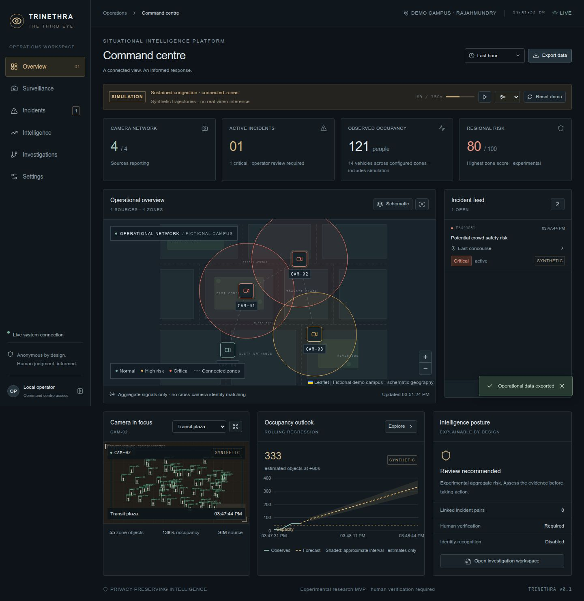

# TRINETHRA

**The Third Eye for Public Safety** · Experimental, local-first situational intelligence.

Trinethra connects camera-local object trajectories to temporal crowd and road signals, correlated incidents, interpretable forecasts, transparent risk components and evidence-grounded investigation. Operators can inspect the exact measurements behind an alert, review connected zones and verify or dismiss a suspected condition. No biometric identification, cross-camera person matching, individual threat scores or autonomous enforcement.



## Run locally

Requires Python 3.12+, Node.js 24 LTS and `uv` (or Python venv/pip). No paid key is needed. All commands run from this repository.

```bash
uv venv --python 3.12 .venv
uv pip install --python .venv/bin/python -c requirements.lock -e '.[test,postgres]'
npm --prefix apps/frontend ci
cp .env.example .env
make migrate
```

Start two terminals:

```bash
make backend
```

```bash
make frontend
```

Open **http://127.0.0.1:3000**. API explorer: **http://127.0.0.1:8000/docs**. The default four-camera synthetic scenario works immediately without model weights, external map tiles or an LLM. The default campus map is explicitly fictional; optional OSM tiles need internet. Server restarts preserve database records; scenario time restarts. Reset demo clears synthetic observations/incidents/reports and preserves video-derived records and audit logs.

For real video inference (additional CPU packages and an explicit model download):

```bash
uv pip install --python .venv/bin/python torch torchvision --index-url https://download.pytorch.org/whl/cpu
uv pip install --python .venv/bin/python -e '.[vision]'
make model
```

In **Surveillance → Add camera**, upload your own permitted video and choose crowd or road analytics. Or place it in `runtime/media/` and enter `media:filename.mp4`. Configure the zone capacity/polygon in Settings. Webcam sources use `webcam:0`. RTSP is disabled by default; enable `ALLOW_NETWORK_STREAMS=true` only for trusted camera networks. Videos play once; Start restarts a finished file. The app stores uploaded files until manually removed; it does not record incoming streams. Do not delete files still used by a camera.

## Implemented MVP

- Next.js/TypeScript command centre, interactive Leaflet map, camera grid/inspection, searchable incident register, forecast charts, investigation workspace and editable settings/ROIs. HTTP polling fallback to authenticated WebSocket updates; loading/error/empty states and responsive mobile navigation.
- FastAPI API, validated inputs, bounded upload, operator token/session cookie, per-client write throttling, structured logs, audit trail, SQLAlchemy persistence and Alembic migration. SQLite default; PostgreSQL configuration and Compose included.
- Independent bounded decoder/inference threads per camera, frame sampling/dropping, reconnecting live inputs, health, CPU/CUDA configuration. YOLO11n + ByteTrack with camera-local expiring trajectory features.
- Polygon occupancy, smoothed counts, growth, concentration, directional flow, persistent congestion, bottlenecks and sudden movement. Road baselines for stationary/restricted vehicles, obstruction, congestion and multi-signal suspected incidents.
- Deduplicated event lifecycle, severity escalation, cooldown, automatic resolution and operator feedback. Connected-camera aggregate event correlation with explanations; simulation never correlates to video inference.
- Rolling regression forecasts with approximate residual intervals and capacity crossing estimates; experimental 0–100 risk with component breakdown and separate signal confidence.
- Read-only LangGraph investigation with retained evidence references, explicit hypotheses, uncertainty, human review steps and deterministic fallback. Optional Ollama/OpenAI-compatible advisory text is clearly unverified and never becomes factual evidence.
- Reproducible synthetic benchmark, real detector/video pipeline smoke scripts, unit/API/integration and Playwright tests, CI configuration, deployment and research documentation.

## Verify

```bash
make test typecheck build evaluate
cd apps/frontend
npx playwright install chromium
npm run test:e2e
```

The browser tests start services if needed and exercise the **disposable synthetic demo**. Do not point them at an operational deployment. The tested Python environment is constrained by `requirements.lock`; CPU Torch wheels use the PyTorch CPU index. Frontend dependencies are locked in `apps/frontend/package-lock.json`. The lock contains optional vision/test/PostgreSQL packages; the default package install intentionally stays lighter.

Actual measurements and their limits: [evaluation report](docs/evaluation.md). Real YOLO and HTTP video ingestion were tested using a short video encoded from a repeated public upstream test photograph. This proves decoding, inference, tracking and API integration, **not natural-motion detection accuracy**. No annotated crowd or accident dataset was available, and no real-world safety accuracy is claimed.

## Configuration

No required environment variables for the local synthetic demo. Set `OPERATOR_TOKEN` for operator authentication; it is **required** with `DEMO_MODE=false`. All configuration is in [.env.example](.env.example). Secrets never enter the database. `DATABASE_URL` selects SQLite/PostgreSQL; `MODEL_PATH`, `DEVICE`, `SAMPLE_FPS`, `INFERENCE_SIZE` configure inference. `LLM_PROVIDER=none|ollama|openai` and related environment variables configure optional advisory generation. Retention and evidence blurring are configurable. The defaults bind only to loopback; this is a research MVP, not an internet-hardened deployment.

## Documentation

- [Architecture and module interfaces](docs/architecture.md)
- [API](docs/api.md) · [Database](docs/database.md)
- [Local installation](docs/installation.md) · [Docker](docs/deployment.md)
- [AI models and thresholds](docs/models.md) · [Evaluation](docs/evaluation.md)
- [Privacy and responsible AI](docs/privacy.md) · [Troubleshooting](docs/troubleshooting.md)
- [Hackathon demonstration](docs/demo.md) · [Presentation outline and innovation](docs/presentation.md)
- [Progress and known limits](PROGRESS.md)

## License

Project source: AGPL-3.0-or-later. Ultralytics code/weights have upstream AGPL/enterprise licensing; review [Ultralytics licensing](https://www.ultralytics.com/license) before alternative distribution. No third-party surveillance footage or model weights are committed. See [datasets/README.md](datasets/README.md).
