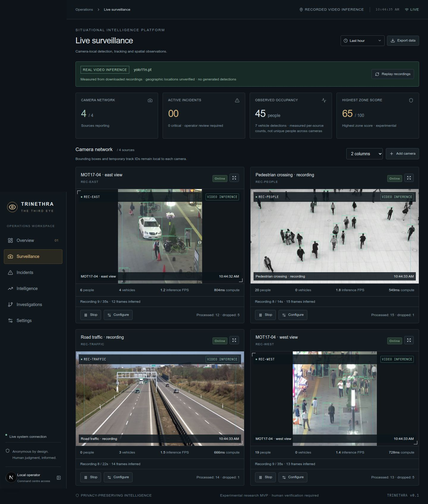

# TRINETHRA

**The Third Eye for Public Safety** — local video situational intelligence with measured evidence and human review.

The default application now runs **real pretrained YOLO + ByteTrack inference on downloaded moving videos**. It does not generate people, detections, counts, trajectories, incidents or chart series. The earlier synthetic scenario remains only as an explicitly enabled test fixture (`SYNTHETIC_MODE=true`).



## Start the installed application

```bash
make run
```

Open **http://127.0.0.1:3000**. This launches FastAPI, Next.js and the local Ollama runtime when available. **Replay recordings** reprocesses the source footage with fresh anonymous tracking. Files play once; the interface shows actual processed frames, dropped frames, media position and measured inference time. Camera inspection includes a browser-compatible source video, publisher URL and SHA-256. No paid API key is needed.

The downloaded inputs are real pedestrian and road recordings from the [Supervision publisher asset collection](https://supervision.roboflow.com/latest/assets/) and raw pedestrian sequences plus training annotations from [MOTChallenge](https://motchallenge.net/data/MOT17/). Source URLs, byte sizes and pinned hashes are in [configs/assets.json](configs/assets.json). Data and model files stay in ignored `runtime/`; they are not redistributed in Git.

## Fresh installation

Requires Python 3.12+, Node.js 24 LTS, `uv`, FFmpeg and optionally [Ollama](https://ollama.com/download) for local language reasoning.

```bash
make setup
cp .env.example .env
make migrate
make browser-install
```

`make setup` installs CPU Torch/YOLO and application dependencies, downloads/verifies two detector models, six real videos and MOT17 annotations, prepares browser playback previews and configures the recording sources. Python must be installed persistently, not under a temporary directory; see [installation](docs/installation.md).

For the local language model, start its server in one terminal and download its model in another:

```bash
make llm
# Separate terminal:
make llm-model
```

Then `make run` starts the application; it reuses that local model service. Qwen2.5 1.5B Q4_K_M is approximately 986 MB. Without it, inference/analytics still work and reports explicitly show deterministic measured evidence rather than pretending model reasoning succeeded.

Separate service commands remain available: `make backend`, `make frontend`, `make llm`. Production frontend: `make build`, then `npm --prefix apps/frontend start` (standalone server, loopback). API explorer: **http://127.0.0.1:8000/docs**.

## What is implemented

- Actual local/uploaded video, webcam and opt-in RTSP adapters; independent bounded decoding/inference workers; cold-model initialization before playback; frame dropping, health, replay and EOF cleanup.
- YOLO11 nano/small models and camera-local ByteTrack; measured normalized boxes, directions, velocities, trajectories, persistent dwell and temporary IDs.
- ROI-based crowd/road observations and temporal rules. Suspected conditions use real measurements and configurable persistence/capacity, not scheduled demo events. Risk scores remain transparent experimental heuristics, not trained danger probabilities.
- Event lifecycle, dedupe/cooldown, evidence JPEGs, human verification/dismissal/resolution and audit logging.
- Explicit aggregate source relationships. The default connected recording views are adjacent crops of one MOT recording, clearly identified as such; an isolated EPFL experiment also verifies real separate synchronized cameras; the project does not misrepresent them as independent physical cameras or verified GPS locations.
- Forecasts fitted to recent measured counts, with rolling validation across regression, last-value and exponential-smoothing baselines. The chosen method, estimates and approximate intervals are displayed honestly.
- Read-only LangGraph investigation with actual retained evidence. Local Qwen answers operator questions and produces structured hypotheses/review steps with validated reference IDs. Facts remain the measured evidence; generated interpretations require human verification.
- Six connected Next.js views, source graph, annotated camera grid, playable recordings, searchable incidents, cited reports, actual-data forecasts, camera/ROI/settings edits and export.
- SQLAlchemy/SQLite persistence, PostgreSQL configuration/migration, authentication, source confinement, upload limits, CORS, write throttling, retention and default evidence blurring.

## Verify actual video behavior

```bash
make test
make typecheck
make build
make e2e
make real-evaluate
```

The default browser suite uses real recordings. Synthetic browser fixtures are opt-in using `E2E_SYNTHETIC=1` and a separate backend with `SYNTHETIC_MODE=true`. Unit tests use clearly labeled generated fixtures to isolate temporal edge cases; they do not constitute real-video model evaluation.

```bash
# With the real application and local language model running:
.venv/bin/python scripts/verify_real_system.py
```

`.venv/bin/python evaluations/physical_cameras.py` reproduces independent-camera correlation using the downloaded EPFL files in an isolated store.

[Real-video evaluation](docs/real-video-evaluation.md) reports actual results, including missed people and tracking errors. The night crowd preview is difficult; measured recall is low. No claim of reliable accident/stampede prediction, physical density/speed or deployment readiness is made. [Older synthetic experiments](docs/evaluation.md) are retained as historical baselines, not evidence of natural-video accuracy.

## Configuration and privacy

Default `SYNTHETIC_MODE=false`; `DEMO_MODE=true` permits local loopback access without a token and does **not** enable simulation. Set `OPERATOR_TOKEN` for authenticated operation; it is required if `DEMO_MODE=false`. `MODEL_PATH`, `INFERENCE_SIZE`, `SAMPLE_FPS` and `TORCH_THREADS` control actual inference. `LLM_PROVIDER=ollama`, `LLM_BASE_URL`, `LLM_MODEL` configure the downloaded local model; `none` deliberately disables it. No secrets enter Git or the database.

No identification, biometrics, demographic inference, person re-identification, individual threat scoring or autonomous enforcement. Default evidence blur covers the upper person-box region; it is not guaranteed face anonymization. Original footage is operator-accessible. Input retention, calibrated predictions, physical camera deployment and named-user access require further work before any operational use.

[Architecture](docs/architecture.md) · [API](docs/api.md) · [Database](docs/database.md) · [Installation](docs/installation.md) · [Docker](docs/deployment.md) · [Models](docs/models.md) · [Privacy](docs/privacy.md) · [Troubleshooting](docs/troubleshooting.md) · [Demonstration](docs/demo.md) · [Progress](PROGRESS.md)

Project source is AGPL-3.0-or-later; respect each model/data publisher's separate terms. No remote push or external deployment is performed automatically.
