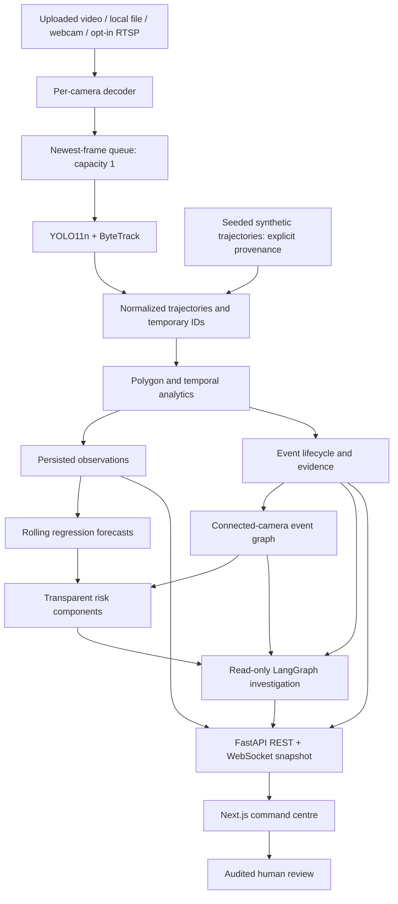

# Architecture

One FastAPI process owns persistence and intelligence state. Each real camera has an independent decoder thread and an inference thread with its own detector/tracker. The default SQLite WAL store and in-process state avoid a mandatory Redis/PostgreSQL installation. PostgreSQL is supported through SQLAlchemy/psycopg and Docker Compose. Redis would add no value to this single-process MVP and is intentionally omitted. Never run multiple Uvicorn workers against this engine: each would start its own scenario and camera workers.

## Interfaces

| Module | Input | Output / responsibility |
| --- | --- | --- |
| `packages/vision/stream.py` | Validated source, sampling FPS | Bounded latest frame/results queues, health and dropped-frame count |
| `packages/vision/detector.py` | Frame and capture timestamp | Class, confidence, normalized box, temporary track ID; measured compute latency |
| `packages/tracking/features.py` | Camera-local detections | Foot position, direction, image-plane velocity, bounded trajectory, dwell and sudden stop |
| `packages/intelligence/analytics.py` | Tracks, ROI, capacity, timestamp | Zone observations and temporally sustained signals; explicit risk components |
| `packages/forecasting/baseline.py` | Recent timestamped counts, capacity, horizon | Regression forecast, residual-based interval, possible crossing time |
| `packages/correlation/graph.py` | Two event records, graph edges, proximity and available flow summaries | Heuristic relationship confidence and explanation; no identity access |
| `packages/investigation/agent.py` | Read-only incident/evidence/graph/history/risk/reference context | LangGraph deterministic report; optional isolated LLM advisory |
| `apps/backend/trinethra/engine.py` | Camera results or synthetic tracks | Transactions, lifecycle, evidence, forecast history, retention, live snapshot |
| `apps/backend/trinethra/api.py` | Authenticated operator request | Validated read/config/review APIs and throttled 1 Hz snapshots |

API handlers and engine ticks execute on the main event loop to serialize state changes. Decoder/inference threads only exchange bounded results and status; they never write the database. Database/analytics/JPEG work is synchronous and can momentarily delay the event loop. This is an explicit scale limit: a large deployment should move inference to processes and batch writes behind a single state owner.

Default files are paced using their reported frame rate, sampled at 2 FPS and played once. Live sources reconnect with bounded waits. Decode frames are resized to at most 1280 pixels on the long side; inference defaults to 640. Result queues hold at most two entries; older results/frames are dropped. A cold model can lose intermediate file frames by design. Live inference FPS is compute throughput, distinct from sampled source rate and delivery latency.

Synthetic scenario time controls the trajectory generator while persistence uses actual UTC capture timestamps. Higher playback speed compresses the scenario; it does not weaken minimum real-time persistence thresholds. At scenario completion the virtual feeds become empty, allowing outstanding conditions to resolve. Pausing simulation freezes frames/observations. Real video workers continue independently.

Event candidates are held in memory as start times, then persisted once the temporal threshold passes. Active/escalated/under-review/verified events update with current factors; a normalization period resolves them. Dismissed or resolved events remain closed, with a cooldown before a new incident can form. Operator verification is recorded independently of lifecycle status. On restart, candidates and rolling windows warm up again; persisted incident history remains.
